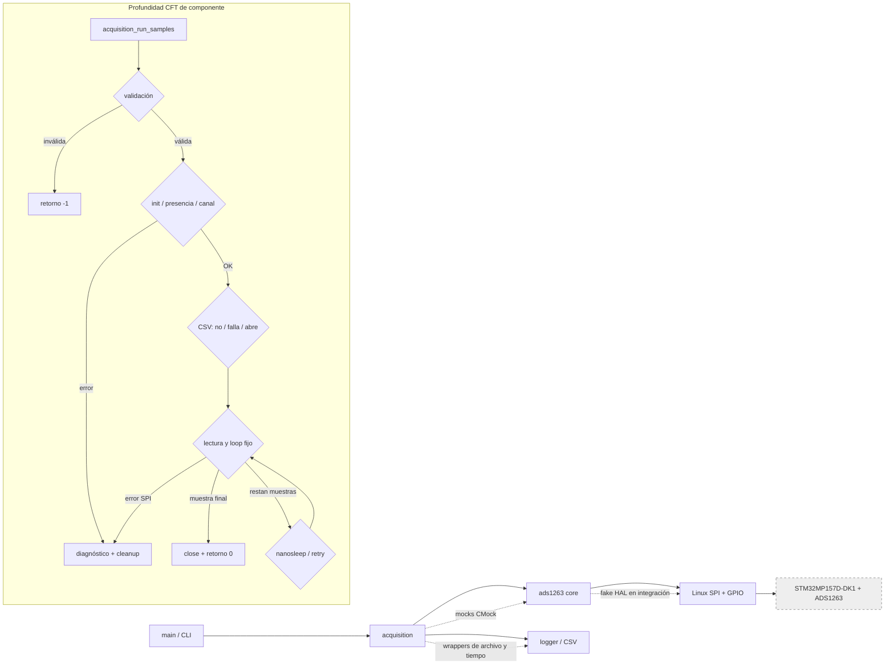

# Informe técnico final de pruebas de software embebido

**Proyecto:** sistema de adquisición basado en STM32MP157D-DK1 y ADS1263 
**Línea base de producción:** `c59b24017f5daebb4e37512d799a0d07f589bce5` 
**Revisión Git usada:** `54a91ed4b684b5ac6f4221c8743768fad5083270` 
**Identidad adicional de inputs:** checksums de inputs test/infraestructura dirty en `docs/tsse/evidencias/01_proyecto/milestone_4_20261015T161203Z/test_input_checksums.typescript` 
**Naturaleza de la evidencia actual:** pruebas y análisis de software en host, sin hardware

La línea base y la revisión Git están registradas respectivamente en `docs/tsse/evidencias/01_proyecto/milestone_1_linea_base.md` y `docs/tsse/evidencias/01_proyecto/milestone_4_20261015T161203Z/README.md`. La guarda contra la línea base terminó con código `0` y sin diferencias en `components/**/*.c`, `components/**/*.h`, `main/*.c` ni `Makefile`; por lo tanto, este trabajo no modificó producción (`docs/tsse/evidencias/01_proyecto/milestone_4_20261015T161203Z/production_guard_before.typescript` y `docs/tsse/evidencias/02_analisis_estatico/milestone_4_20261015T161203Z/README.md`). HEAD no identifica por sí solo los inputs de ejecución: las pruebas formales usaron además cambios test/infraestructura dirty identificados por el transcript de checksums. Ese manifest se capturó después de ejecutar, sobre inputs que permanecieron sin cambios hasta la captura; no existe un commit ni un manifest pre-ejecución de esos cambios.

## 1. Contexto del proyecto y del sistema

El producto es una aplicación en C para Linux embebido que adquiere conversiones de un ADS1263 desde una STM32MP157D-DK1. Sus requisitos abarcan ejecución en target, acceso SPI por `/dev/spidev0.0`, lectura de DRDY en `/dev/gpiochip6` línea `8`, comprobación de registros, adquisición fija y continua, salida CSV y rechazo de parámetros inválidos (`docs/requirements.md`).

El repositorio contiene casos de aceptación para cross-build ARM, preparación del target, conexión y desconexión física, potenciómetro, modo live y CSV (`docs/acceptance_tests.md`). El Master Test Plan también declara que el software original ya había sido validado funcionalmente en placa (`docs/tsse/master_test_plan.md`). Sin embargo, no se adjunta en el repositorio un log primario de aquella campaña; por ello se la considera **antecedente histórico del proyecto**, no evidencia reproducible de esta ejecución TSSE (`docs/tsse/discrepancias.md`, DSP-016).

La evidencia presentada en este informe fue obtenida en Ubuntu x86-64 y no utilizó STM32MP157D-DK1, ADS1263 físico, SDK de target, `/dev/spidev*` ni `/dev/gpiochip*`. Esta clasificación consta en `docs/tsse/evidencias/01_proyecto/milestone_1_linea_base.md`, `docs/tsse/evidencias/07_defectos_regresion/milestone_3a_20261015T150616Z/README.md` y `docs/tsse/evidencias/05_integracion_host/milestone_4_20261015T161203Z/run_1/summary.json`.

## 2. Arquitectura del software

La arquitectura productiva separa `main` (CLI y selección de modo), `acquisition` (orquestación), `ads1263` (protocolo, registros, canal y conversión), adaptadores Linux SPI/GPIO y `logger` (consola/CSV), según `docs/architecture.md`. El flujo nominal configura el dispositivo, comprueba presencia, selecciona `AIN0-AINCOM`, envía `START1`, obtiene muestras mediante `RDATA1`, registra resultados y libera recursos.

El siguiente diagrama resume a la vez la arquitectura y la frontera del CFT. Los bloques continuos son producción; los contratos de prueba sustituyen solamente la frontera indicada.

La API core no está completamente desacoplada de Linux: `components/ads1263/include/ads1263.h` incluye los headers de ambos adaptadores y embebe sus tipos en `ads1263_t`. Este hecho es relevante para REQ-012 y se trata como incertidumbre arquitectónica, no como defecto demostrado (`docs/tsse/discrepancias.md`, DSP-003).

## 3. Alcance y Master Test Plan

El objetivo fue verificar software existente con análisis estático, CFT, pruebas unitarias, cobertura e integración nativa con dependencias simuladas. El alcance incluye driver ADS1263, control de adquisición, validación, conversión, errores software e interacciones entre módulos; excluye validación eléctrica, señales SPI físicas, potenciómetro, cross-build/despliegue y temporización real del target (`docs/tsse/master_test_plan.md`).

El MTP prioriza funcionalidad `45 %`, confiabilidad `30 %`, mantenibilidad `15 %` y eficiencia `10 %`; no fija un umbral mínimo de cobertura (`docs/tsse/master_test_plan.md`). La eficiencia se limita a indicadores de control de flujo en host, como ausencia de espera después de la última muestra y terminación acotada, sin extrapolarlos a tiempo real.

| Actividad | SUT y objetivo | Evidencia que no proporciona |
|---|---|---|
| Inspección estática | Todos los C/H productivos; estructura, contratos y diagnósticos | Comportamiento dinámico |
| Unitarias ADS1263 | `ads1263.c` real, HAL controlado; tramas, conversiones, límites y errores | Bus o ADC físico |
| CFT/unitarias acquisition | `acquisition.c` real; rutas, orden, conteos, archivo y cleanup | Internos del driver/HAL |
| Integración host | `main`, acquisition, core y logger reales; CLI, CSV, SIGINT y propagación | Target, electricidad y timing real |
| Integración HW/SW | Fuera del alcance de esta campaña | Cierre de requisitos físicos |

La definición de niveles y límites está en `docs/tsse/master_test_plan.md`; la clasificación requisito por requisito está en `docs/tsse/matriz_trazabilidad.md`. En todos los niveles se preservó la fuente de producción y se mantuvieron separados los estados `PASS`, `FAIL`, `BLOCKED`, `NOT RUN` y `OUT OF SCOPE`.

## 4. Diseño y derivación formal CFT

El CFT toma como raíz `acquisition_run_samples()` y expande todos los helpers locales alcanzables de `components/acquisition/src/acquisition.c`; ADS1263, logger, archivos y tiempo se modelan como contratos externos. Esta profundidad evita tanto omitir decisiones internas de acquisition como mezclar el componente con paths del driver y HAL (`docs/tsse/cft_acquisition_run_samples.md`).

El CFG normalizado contiene `32` decisiones binarias, D01..D32. Con la convención para grafo conectado y decisiones atómicas, su complejidad ciclomática es `V(G) = D + 1 = 33`; la derivación y el reparto por región son reproducibles desde `docs/tsse/cft_acquisition_run_samples.md` y `docs/tsse/evidencias/03_cft/acquisition_run_samples_cfg.dot`. Ese valor es una dimensión estructural, no la cantidad de paths factibles.

Se descartaron como no factibles desde la raíz fija las ramas live, la iteración fija de cero muestras, el canal inválido después de validar, el rate cero después de validar y condiciones de snapshot nulo creadas dentro de helpers. También se separaron los retries ambientales potencialmente ilimitados. Sobre esa base se seleccionaron `24` paths CFT factibles, CFT-P01..CFT-P24 (`docs/tsse/cft_cases.md`).

La derivación cubre:

| Familia | Particiones o rutas |
|---|---|
| Validación | `samples={0,1,1000,1001}`, `rate_hz={0,1,10,11}`, `channel={0,no soportado}` |
| Preparación | Fallos de init SPI/GPIO/genérico; presencia ZERO/FLOATING/MISMATCH/IO; fallo de configuración |
| Archivo | Sin CSV, apertura fallida y apertura exitosa con header/cierre |
| Loop | Éxito de una y dos muestras, back edge, fallo en primera o segunda lectura, retry por `EINTR` |
| Cleanup | Cierre condicionado por el recurso adquirido y cierre CSV antes del ADC |

Los valores y oráculos completos están en `docs/tsse/cft_cases.md`; las secuencias exactas se vinculan con los nodos del CFG. Por ejemplo, CFT-P21 exige dos lecturas, dos outputs, un back edge, una espera y cierre final. La revisión histórica de diseño conserva que en Milestone 1 estaban `NOT RUN` (`docs/tsse/evidencias/03_cft/milestone_1_revision_casos_cft.md`), mientras el registro vigente y la evidencia actual demuestran la ejecución de los `24` casos: son las primeras `24` entradas `PASS` de `docs/tsse/evidencias/04_unitarias/milestone_4_20261015T161203Z/acquisition_tests_report.json`.

## 5. Arquitectura de pruebas unitarias automatizadas

Ceedling `1.1.10`, Unity y CMock compilan directamente las unidades productivas, sin copias del algoritmo. El proyecto ADS1263 enlaza `components/ads1263/src/ads1263.c`; el proyecto acquisition enlaza `components/acquisition/src/acquisition.c` (`project.yml` y `test/ceedling/project_acquisition_robustness.yml`). Ambos fuerzan ejecución serial dentro del proyecto y usan C11.

La separación de dependencias es la siguiente:

| SUT real | Doubles/seams de prueba | Observables principales |
|---|---|---|
| `ads1263.c` | Mocks CMock de SPI/GPIO y wrapper de `nanosleep` | Tramas, argumentos, orden, status, buffers y tiempos solicitados |
| `acquisition.c` | Mock CMock de API ADS1263; wrappers test-only de `fopen`, `fputs`, `fclose`, `printf` y `nanosleep` | Retorno, eventos ordenados, logs, muestras, header, archivo y cleanup |

La configuración estricta de acquisition exige orden de mocks y rechaza llamadas inesperadas (`test/ceedling/project_acquisition_robustness.yml`). El event spy y los scripts de muestras se implementan en `test/ceedling/tests_acquisition_robustness/test_acquisition_cft.c`; los seams de archivo y espera están declarados en `test/ceedling/support/stdio_wrapper.h` y `test/ceedling/support/wait_wrapper.h`. Ninguno requiere dispositivos físicos.

El inventario automatizado único vigente comprende `72` casos unitarios no CFT: `66` del core ADS1263 y `6` de robustez de acquisition. Los `66` constan en `docs/tsse/evidencias/04_unitarias/milestone_4_20261015T161203Z/ads1263_tests_report.json`; los `6` son los casos posteriores a CFT-P24 en `docs/tsse/evidencias/04_unitarias/milestone_4_20261015T161203Z/acquisition_tests_report.json`. A ellos se agregan, como inventario separado, los `24` casos derivados del CFT en ese mismo reporte de acquisition.

## 6. Integración de software en host

El build de integración genera dos ejecutables nativos. El primero enlaza `main/main.c`, acquisition, ADS1263, logger y ambos adaptadores Linux productivos con `ADS1263_NO_GPIOD=1`; los comandos aceptados usan el mock incorporado, por lo que no invocan los adaptadores. El segundo conserva `main`, acquisition, ADS1263 y logger, pero reemplaza ambos objetos de adaptador por `test/integration/fake_hal/fake_hal.c`. El comando, las fuentes y sus hashes están en `docs/tsse/evidencias/05_integracion_host/milestone_4_20261015T161203Z/build_manifest.json`; ambos binarios se construyeron correctamente según `docs/tsse/evidencias/05_integracion_host/milestone_4_20261015T161203Z/01_build.typescript`.

Los `71` escenarios declarados se distribuyen entre CLI, adquisición mock, creación/truncado/fallo no fatal de CSV, observación con `strace`, live controlado con SIGINT y fake HAL (`test/integration/scenarios.md`). Dentro de ese conjunto hay `4` casos fake-HAL: muestra nominal, DRDY demorado, fallo de transferencia de muestra y fallo de presencia (`test/integration/scenarios.md`). Los dos runs formales repitieron los mismos 71 IDs y los mismos estados: `71 PASS`, `0 FAIL`, `0 BLOCKED` en cada run, sin IDs omitidos ni extra (`docs/tsse/evidencias/05_integracion_host/milestone_4_20261015T161203Z/README.md`).

La integración aporta evidencia de proceso real para:

- gramática, límites, overflow, opciones faltantes y conflictos de modo de la CLI;
- filas y conteos CSV, truncado, continuidad ante apertura fallida y correlación `openat`/`close` con `strace`;
- terminación live por SIGINT sin proceso residual;
- framing, polling DRDY, decodificación, propagación SPI y cleanup mediante fake HAL;
- ausencia observada de accesos a `/dev/spidev*` y `/dev/gpiochip*` en el escenario instrumentado.

No aporta evidencia de `open`/`ioctl`/libgpiod reales, señales, placa o ADC físico. Estas fronteras están declaradas en `test/integration/README.md`, `test/integration/scenarios.md` y en ambos `summary.json` de ejecución.

## 7. Resultados reales de ejecución

Los conteos siguientes son inventarios únicos; las repeticiones formales no se suman como casos nuevos.

La identidad reproducible de esta ejecución es compuesta: HEAD `54a91ed4b684b5ac6f4221c8743768fad5083270`, el estado dirty observado y los SHA-256 de `docs/tsse/evidencias/01_proyecto/milestone_4_20261015T161203Z/test_input_checksums.typescript`. El transcript fue generado después de los runs a partir de los mismos inputs sin cambios; por esa razón permite identificar el estado usado, pero no se presenta falsamente como captura o commit pre-ejecución. Una reconstrucción desde HEAD solamente omitiría tests, wrappers, configuración e infraestructura de integración utilizados formalmente.

| Conjunto automatizado | Casos únicos | Resultado actual | Evidencia exacta |
|---|---:|---|---|
| Unitarios ADS1263 core | `66` | `66 PASS`, `0 FAIL` | `docs/tsse/evidencias/04_unitarias/milestone_4_20261015T161203Z/ads1263_tests_report.json`; transcript exitoso `03_ads1263_clean_test_all_pass.typescript` |
| Unitarios acquisition no CFT | `6` | `6 PASS`, `0 FAIL` | seis entradas de robustez en `docs/tsse/evidencias/04_unitarias/milestone_4_20261015T161203Z/acquisition_tests_report.json` |
| Unitarios derivados del CFT | `24` | `24 PASS`, `0 FAIL` | CFT-P01..CFT-P24 en `docs/tsse/evidencias/04_unitarias/milestone_4_20261015T161203Z/acquisition_tests_report.json` |
| Integración formal, run 1 | `71` | `71 PASS`, `0 FAIL`, `0 BLOCKED` | `docs/tsse/evidencias/05_integracion_host/milestone_4_20261015T161203Z/run_1/summary.json` |
| Integración formal, run 2 | `71` | `71 PASS`, `0 FAIL`, `0 BLOCKED` | `docs/tsse/evidencias/05_integracion_host/milestone_4_20261015T161203Z/run_2/summary.json` |

Un `PASS` de un caso que espera exit no cero significa que el proceso rechazó o propagó el error conforme al oráculo; no significa que todos los comandos hayan terminado con exit cero. Esto puede verse, por ejemplo, en HAL-READ-FAILURE y HAL-PRESENCE-FAILURE dentro de ambos `summary.json`.

Separadamente, PROC-DSP017-001 es una reproducción de conformidad fallida que confirmó DEF-001: con `samples=2` y `rate_hz=1`, el proceso real de acquisition no terminó antes del timeout externo y fue finalizado con exit `124` (`docs/tsse/evidencias/07_defectos_regresion/milestone_3a_20261015T150616Z/DEF-001-DSP017-rate-1-livelock.md`). Este `FAIL` no se oculta ni se agrega al inventario de casos `PASS`.

### Incidencias de infraestructura y reruns

| Incidencia preservada | Diagnóstico | Resolución y evidencia válida |
|---|---|---|
| Primer run unitario ADS1263 de Milestone 4 | El linker no resolvió `__real_fopen`, `__real_fputs` y `__real_fclose` al compilar soporte destinado a acquisition | Se acotó el wrapper mediante configuración test-only; el rerun limpio terminó `66/66 PASS` en `docs/tsse/evidencias/04_unitarias/milestone_4_20261015T161203Z/03_ads1263_clean_test_all_pass.typescript`; el fallo permanece en `01_ads1263_clean_test_all.typescript` |
| Export de cobertura acquisition lanzado junto al perfil ADS1263 | Colisión de `.gcda`, checksum/stamp mismatch y salida `1`; no fue un fallo de test de producto | El rerun serial generó reportes y terminó con salida `0` en `docs/tsse/evidencias/06_cobertura/milestone_4_20261015T161203Z/03_acquisition_coverage_serial_pass.typescript`; el intento excluido está en `02_acquisition_coverage.typescript` |
| Primer build del probe DEF-001 | Faltaba el fake de `ads1263_read_drdy` | Corrección solo de soporte y build posterior exitoso; ambos intentos están explicados en `docs/tsse/evidencias/07_defectos_regresion/milestone_3a_20261015T150616Z/README.md` |
| Export gcovr ADS1263 previo | Carrera entre dos procesos gcovr | El fallo y el rerun serial exitoso se conservan y distinguen en `docs/tsse/evidencias/06_cobertura/milestone_3a_20261015T150616Z/README.md` |
| Cppcheck inicial | Dos avisos `normalCheckLevelMaxBranches` impedían llamarlo exhaustivo | El seguimiento con `--check-level=exhaustive` completó todo el alcance; política y resultado en `docs/tsse/evidencias/02_analisis_estatico/milestone_4_20261015T161203Z/03_exhaustive_followup_policy.md` y `findings.md` |

Los resultados cuantitativos de este informe proceden únicamente de los reruns y exports exitosos indicados.

## 8. Cobertura de código

Se usaron perfiles GCC/gcov/gcovr separados y filtros restringidos al módulo productivo. Tests, runners, mocks, framework y soporte no integran el denominador. El MTP no define un porcentaje de aceptación, por lo que estas métricas describen alcance observado y no constituyen por sí solas un gate.

| Módulo productivo | Líneas | Funciones | Ramas | Evidencia actual |
|---|---:|---:|---:|---|
| `components/ads1263/src/ads1263.c` | `151/222 (68.0 %)` | `13/16 (81.2 %)` | `90/134 (67.2 %)` | `docs/tsse/evidencias/06_cobertura/milestone_4_20261015T161203Z/ads1263/GcovCoverageResults.html` |
| `components/acquisition/src/acquisition.c` | `118/168 (70.2 %)` | `9/13 (69.2 %)` | `53/76 (69.7 %)` | `docs/tsse/evidencias/06_cobertura/milestone_4_20261015T161203Z/acquisition/GcovCoverageResults.html` |

El valor anterior de acquisition era `54/168` líneas, `6/13` funciones y `26/76` ramas, medido con los `6` casos de robustez (`docs/tsse/evidencias/06_cobertura/milestone_3a_20261015T150616Z/README.md`). La incorporación de los `24` CFT elevó la cobertura actual a los valores de la tabla; no demuestra todos los paths posibles. En ADS1263 permanecen sin ejecutar, entre otros, partes de init/close y varios textos de status; en acquisition quedan fuera del perfil unitario funciones de check/live/default y su handler, identificadas en los reportes HTML de cada módulo.

## 9. Análisis estático

Cppcheck `2.19.0` analizó el perfil `ADS1263_NO_GPIOD=1` sobre los `6` archivos C y `6` headers de producción, con C11, plataforma unix64, biblioteca POSIX, `--enable=all`, `--inconclusive`, `--force`, sin supresiones y con seguimiento exhaustivo. La versión, el alcance y el comando exacto están en `docs/tsse/evidencias/02_analisis_estatico/milestone_4_20261015T161203Z/README.md` y `00_policy.md`.

| Resultado | Cantidad | Disposición | Evidencia |
|---|---:|---|---|
| Diagnósticos de fuente Cppcheck | `41` | Todos `style`; no son defectos confirmados | `docs/tsse/evidencias/02_analisis_estatico/milestone_4_20261015T161203Z/findings.md` |
| Falsos positivos por contexto/herramienta | `38` | Escritura indirecta de `ioctl` y miembros aparentemente no usados al analizar headers como unidades primarias | `docs/tsse/evidencias/02_analisis_estatico/milestone_4_20261015T161203Z/findings.md`, SA-CPPCHECK-001..038 |
| Observaciones aceptadas de API pública | `3` | Funciones deliberadamente públicas aunque Cppcheck propone `static`; riesgo bajo de superficie | `docs/tsse/evidencias/02_analisis_estatico/milestone_4_20261015T161203Z/findings.md`, SA-CPPCHECK-039..041 |
| Limitaciones `missingIncludeSystem` | `32` | Retenidas, no suprimidas; limitan el modelo de headers del analizador | `docs/tsse/evidencias/02_analisis_estatico/milestone_4_20261015T161203Z/findings.md`, SA-ENV-001..032 |
| Defectos confirmados por análisis estático | `0` | Ningún diagnóstico demostró defecto productivo | `docs/tsse/evidencias/02_analisis_estatico/milestone_4_20261015T161203Z/README.md` |
| Diagnósticos GCC fallback | `0` | Perfil informativo, salida `0`, stdout/stderr vacíos | `docs/tsse/evidencias/02_analisis_estatico/milestone_4_20261015T161203Z/raw_analysis/003_gcc15_no_gpiod.exitcode.txt`, `docs/tsse/evidencias/02_analisis_estatico/milestone_4_20261015T161203Z/raw_analysis/003_gcc15_no_gpiod.stdout.txt` y `docs/tsse/evidencias/02_analisis_estatico/milestone_4_20261015T161203Z/raw_analysis/003_gcc15_no_gpiod.stderr.txt` |

No corresponde describir Cppcheck como “clean”: completó el perfil no-gpiod con diagnósticos y éstos fueron revisados. La configuración real libgpiod v2, `ADS1263_NO_GPIOD=0`, quedó `BLOCKED`: `pkg-config` no estaba disponible (exit `127`) y el probe de `gpiod.h` falló (exit `1`). La evidencia está en `docs/tsse/evidencias/02_analisis_estatico/milestone_4_20261015T161203Z/README.md` y `raw_analysis/002_cppcheck_libgpiod_v2.reason.txt`. El fallback GCC tampoco cubre esa rama.

## 10. Defectos, hallazgos y ambigüedades

| ID | Clasificación actual | Evidencia y efecto | Disposición |
|---|---|---|---|
| DEF-001 / DSP-017 | Defecto confirmado | Para `rate_hz=1`, `sleep_for_rate()` genera `{0,1000000000}`; POSIX retorna `EINVAL` y el retry no progresa. Fixed mode con `N>=2` queda en livelock; el probe termina por timeout con exit `124` | Abierto; no se autorizó corrección de producción. `docs/tsse/evidencias/07_defectos_regresion/milestone_3a_20261015T150616Z/DEF-001-DSP017-rate-1-livelock.md` |
| ROB-001 / FND-ROB001-001 | Defecto sospechado | `start=31,count=2` cruza el arreglo de registros y lee/escribe el byte adyacente dentro de `ads1263_t`; normal, ASan y UBSan reproducen el efecto pero no emiten diagnóstico | Requiere contrato aprobado para el rango combinado; no se promueve a defecto confirmado. `docs/tsse/evidencias/07_defectos_regresion/milestone_3a_20261015T150616Z/README.md` |
| ROB-002 | Comportamiento esperado en fronteras ejecutadas | El core propaga fallos SPI y suprime operaciones posteriores; CFT-P20/P22/P24 verifica la respuesta de acquisition; HAL-READ-FAILURE verifica proceso, protocolo y cleanup con fake HAL | `PASS` en core, CFT y fake HAL; no cubre `ioctl` real. `docs/tsse/evidencias/04_unitarias/milestone_4_20261015T161203Z/ads1263_tests_report.json`, `acquisition_tests_report.json` y `docs/tsse/evidencias/05_integracion_host/milestone_4_20261015T161203Z/run_1/summary.json` |
| ROB-003 / DSP-011 | Ambigüedad contractual | GPIO_READ/timeout con SPI exitoso produce muestra y retorno OK con estado diagnóstico; si SPI falla, retorna SPI_TRANSFER y acquisition aborta | Caracterización `PASS`, pero no existe contrato aprobado que exija que DRDY sea fatal. `docs/tsse/evidencias/07_defectos_regresion/milestone_3a_20261015T150616Z/README.md` |

Los diagnósticos de Cppcheck no agregaron defectos confirmados. DEF-001 fue detectado dinámicamente contra REQ-008 y el rango de rate aceptado; ROB-001 y ROB-003 permanecen deliberadamente en categorías distintas para no convertir riesgo u observación en requisito.

## 11. Discrepancias, incertidumbre y limitaciones

| Tema exigido para cierre | Estado factual | Consecuencia |
|---|---|---|
| Hardware y requisitos físicos | REQ-001 requiere target; partes de REQ-002, REQ-005, REQ-006 y REQ-007 dependen de hardware. La campaña actual no usó dispositivos; la validación en placa es histórica y no tiene raw log adjunto (`docs/tsse/matriz_trazabilidad.md`; `docs/tsse/discrepancias.md`) | No se concluye cumplimiento físico, eléctrico, de exactitud ADC ni temporal |
| REQ-012 | Las implementaciones Linux están bajo `arch/linux`, pero `ads1263.h` incluye y expone tipos Linux (`components/ads1263/include/ads1263.h`; `docs/tsse/discrepancias.md`, DSP-003) | `BLOCKED/UNRESOLVED` hasta definir si “aislado” significa ubicación o independencia de API |
| Semántica CSV | La arquitectura dice append, pero la fuente usa modo `"w"`; si `fopen` falla, advierte y continúa (`docs/architecture.md`; `components/acquisition/src/acquisition.c`; `docs/tsse/discrepancias.md`, DSP-005/006) | Truncado y continuidad están caracterizados; falta decidir si la apertura fallida debe ser fatal |
| ROB-001 | Se observa cruce intraobjeto; ASan/UBSan silenciosos no prueban seguridad (`docs/tsse/evidencias/07_defectos_regresion/milestone_3a_20261015T150616Z/README.md`) | Sigue sospechado hasta aprobar contrato de rechazo/status |
| ROB-003 | Se conocen las combinaciones DRDY/SPI y su consecuencia en acquisition, pero no la política normativa (`docs/tsse/evidencias/07_defectos_regresion/milestone_3a_20261015T150616Z/README.md`) | Ambigüedad, no defecto confirmado |
| Rama estática libgpiod v2 | Cppcheck y GCC para `ADS1263_NO_GPIOD=0` están `BLOCKED` por falta de `pkg-config` y `gpiod.h` (`docs/tsse/evidencias/02_analisis_estatico/milestone_4_20261015T161203Z/README.md`) | No existe afirmación “clean” ni cobertura estática de esa configuración |
| Adaptadores Linux | El binario mock los enlaza pero no los invoca; el fake HAL los reemplaza. No hay test unitario actual de `open`, `ioctl` o libgpiod (`test/integration/README.md`; `test/integration/scenarios.md`) | REQ-002/003 sólo queda parcialmente respaldado por inspección y simulación de protocolo |
| Errores de escritura/flush/cierre | Se verifican header, filas, truncado y cierre normal correlacionado por `strace`, pero no se inyectan errores de write, flush o close (`test/integration/scenarios.md`; ambos `summary.json` de integración) | La robustez de persistencia y reporte de esos errores permanece sin probar |

Otras limitaciones: el máximo `samples=1000` se valida en integración mediante el short-circuit de help, no ejecutando una adquisición larga; la cobertura no prueba ausencia de defectos; el pacing host no equivale a performance del target; y el fake HAL verifica protocolo/orquestación, no el kernel Linux ni la forma de onda. Estas limitaciones están registradas en `test/integration/scenarios.md`, `docs/tsse/master_test_plan.md` y los `summary.json` de integración.

### Inventario final pendiente, bloqueado y abierto

| Clase | Inventario explícito al cierre documental |
|---|---|
| Unitarios legacy `NOT RUN` | `UT-CFG-002`, `UT-SPI-001-A`, `UT-SPI-001-B`, `UT-SPI-002`, `UT-SPI-003`, `UT-SPI-004`, `UT-SPI-005` |
| Integración legacy `NOT RUN` | `INT-ACQ-001`, `INT-ACQ-002`, `INT-CSV-001`, `INT-CSV-002`, `INT-CSV-003`, `INT-LIVE-001`, `INT-LIVE-002`, `CLI-004-D`, `CLI-005`, `CLI-006-F`; el balance del catálogo es `19 PASS`/`10 NOT RUN` |
| Cierre humano `BLOCKED / PENDING HUMAN` | Aprobación factual del informe pendiente de revisor humano y rehearsal pendiente de entrega humana; condiciones de desbloqueo registradas y tareas no completadas |
| `BLOCKED` por entorno | ANA-STATIC-002, análisis libgpiod-v2, por ausencia de `pkg-config` y `gpiod.h` |
| `BLOCKED/UNRESOLVED` por contrato | ARCH-001/REQ-012, hasta definir el criterio de aislamiento Linux |
| Defecto confirmado abierto | DEF-001/DSP-017, sin corrección de producción autorizada |
| Hallazgos/decisiones abiertas | ROB-001/FND-ROB001-001; política fatal/no fatal de CSV (DSP-006); política DRDY (ROB-003/DSP-011); estado de inicialización (DSP-012); alineación contractual de CSV con check (DSP-008) |
| Fuera de alcance actual | Hardware/target, SPI/GPIO físicos, exactitud ADC, tiempo real, adaptadores Linux reales y errores de write/flush/close |

CLI-006-F conserva el input exacto `--live --channel 0 --rate-hz 2 --csv out.csv --mock` y sigue `NOT RUN`. `CLI-LIVE-CSV` pasó con `--live --csv unused.csv --mock`; es evidencia cercana del diagnóstico, no una ejecución exacta del caso legacy. El inventario detallado y reconciliado está en `docs/tsse/evidencias/08_trazabilidad/milestone_4_20261015T161203Z/final_status_inventory.md` e `integration_case_traceability.md`.

### Inventario completo de discrepancias

El registro autoritativo, con evidencia, impacto y disposición por fila, es `docs/tsse/discrepancias.md`. El índice completo vigente es:

| ID | Tema y disposición resumida |
|---|---|
| DSP-001 | Alcance legacy/hardware fuera de la campaña host |
| DSP-002 | “Host build” histórico es cross-build legacy |
| DSP-003 | Criterio REQ-012 requiere decisión; ARCH-001 bloqueado |
| DSP-004 | Frontera logger/CSV aceptada para el diseño observado |
| DSP-005 | Append frente a truncado caracterizado; ambigüedad documental |
| DSP-006 | Fallo de apertura CSV caracterizado como no fatal; contrato pendiente |
| DSP-007 | Orden HELP/modos caracterizado |
| DSP-008 | CSV con check caracterizado; alineación contractual pendiente |
| DSP-009 | `rate_hz` es pacing aproximado, no garantía temporal |
| DSP-010 | ROB-001/FND-ROB001-001 sospechado, sin promoción a defecto confirmado |
| DSP-011 | ROB-003 caracterizado; política DRDY contractual pendiente |
| DSP-012 | Uso de `initialized` pendiente de caracterización específica |
| DSP-013 | STOP1/estado físico fuera del alcance host actual |
| DSP-014 | Extracto CFT histórico no se usa como prueba de CFT completado |
| DSP-015 | Evidencia Cppcheck histórica incompleta; la ejecución Milestone 4 se registra por separado |
| DSP-016 | Validación física histórica sin raw log se conserva sólo como antecedente |
| DSP-017 | DEF-001 confirmado y abierto |

## 12. Conclusiones y estado de revisión

La campaña construyó una verificación host repetible sobre código productivo intacto y sobre inputs test/infraestructura identificados por checksum. El resultado actual es consistente en tres niveles: `72` unitarias no CFT (`66` ADS1263 + `6` acquisition), un inventario separado de `24` paths CFT de acquisition e integración de proceso con CLI/CSV/`strace`/SIGINT/fake HAL. Las dos corridas formales de integración repitieron los mismos 71 IDs y estados, mientras la cobertura de acquisition aumentó respecto de la medición previa. El análisis estático produjo diagnósticos revisados, ninguna confirmación adicional de defecto y un bloqueo explícito para libgpiod v2. La reproducibilidad no se atribuye a HEAD solo: depende también de los inputs dirty del manifest post-ejecución y del entorno registrado.

La conclusión técnica no es que el sistema completo esté validado: la evidencia actual sólo respalda contratos de software dentro de fronteras controladas. DEF-001 permanece abierto; ROB-001 sigue sospechado; ROB-003, REQ-012 y la política de fallo CSV necesitan decisión; hardware, adaptadores Linux reales y fallos de persistencia continúan fuera o pendientes.

**Estado de revisión factual:** contenido técnico preparado y trazado a evidencia del repositorio; aprobación del revisor humano pendiente. No se declara completada la tarea OpenSpec 14.3.
