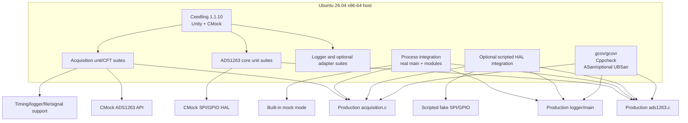
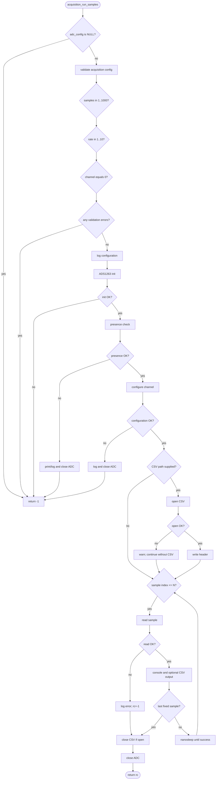
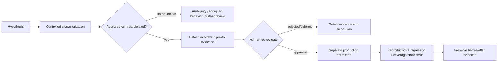

# Design

## Context

See `proposal.md` for motivation and scope. Production commit `c59b24017f5daebb4e37512d799a0d07f589bce5` contains a C11 Linux application with a monolithic production Makefile and no Ceedling project, automated test source, or coverage configuration.

The observed runtime dependency chain is:

```text
main
  -> acquisition
       -> ads1263 core
            -> Linux SPI adapter -> open/ioctl/close
            -> Linux GPIO adapter -> libgpiod v2
       -> logger
       -> stdio, signal, nanosleep
```

The ADS1263 public header includes Linux adapter headers and embeds Linux adapter types. This means acquisition tests that mock `ads1263.h` still need the Linux adapter include directory, and the current implementation does not fully abstract Linux types despite the wording of REQ-012. The design works with this existing structure; it does not refactor production merely to improve testability.

Existing TSSE decisions are retained: host-native execution, no physical hardware requirement, CFT for acquisition, Ceedling/Unity/CMock for unit tests, gcov/gcovr for coverage, Cppcheck for static analysis, and the existing quality/subsystem priority percentages. Existing evidence is planning input only: the saved CFT source excerpt is not a verified CFG, the one-line Cppcheck artifact is not a complete analysis result, and no execution or coverage result currently exists.

## Goals / Non-Goals

**Goals:**

- Exercise actual production translation units on x86-64 with deterministic substitutes for physical and nondeterministic dependencies.
- Produce an independently reviewable acquisition CFT model and derive explicit system-level cases from it.
- Preserve exact commands, raw outputs, result states, coverage scope, and defect/regression history.
- Keep unit, integration, static, sanitizer, and coverage profiles distinguishable so one tool does not invalidate another tool's evidence.
- Make every claim proportional to the boundary exercised.
- Provide a concise factual index from academic objectives to retained technical evidence.

**Non-Goals:**

- Introducing a new HAL or changing public production interfaces solely for tests.
- Directly exposing static helpers or compiling copied source bodies into tests.
- Treating built-in mock mode as protocol, Linux adapter, or hardware verification.
- Establishing hard real-time guarantees or a coverage pass percentage.
- Resolving application contract ambiguities by assertion alone.
- Authoring or approving the final academic LaTeX report, Google Slides presentation, speaker notes, or rehearsal; those deliverables are external to this implementation workflow.

## Decisions

### 1. Keep production and test builds separate

The existing Makefile remains the production/target-oriented build. A Ceedling configuration will provide native test compilation with C11, `_POSIX_C_SOURCE=200809L`, the existing component include paths, and dedicated normal, coverage, and sanitizer output directories.

Production `.c` files will be referenced directly. Tests will not `#include` production `.c` files, redefine `static`, add `#ifdef UNIT_TEST`, or duplicate algorithms. `main/main.c` will not enter ordinary Unity runners because both define `main`; CLI behavior will use a dedicated executable or process-level integration path.

Alternative considered: adapt the production Makefile into a test runner. Rejected because it mixes target dependencies and native testing, makes CMock generation awkward, and weakens build/evidence separation.

### 2. Use layered host-test architecture

The proposed architecture is shown below. It is a design target, not evidence that these suites already exist.



Unit tests establish local behavior and error propagation. Process integration establishes CLI and cross-module behavior with simulated hardware. Optional scripted HAL integration is accepted only if it adds meaningful confidence after unit suites and can be built without production changes.

Alternative considered: rely exclusively on `--mock`. Rejected because built-in mock paths bypass SPI command framing, GPIO polling, signed sample parsing, and transport failures.

### 3. Isolate dependencies at existing seams

| Unit under test | Dependency | Test substitute | Reason |
|---|---|---|---|
| `ads1263.c` | `ads1263_spi_linux_*` | CMock mock with transfer callback | Verifies TX bytes/length and injects RX/status without `spidev` |
| `ads1263.c` | `ads1263_gpio_linux_*` | CMock mock | Scripts ready, busy, and read-error states |
| `ads1263.c` | `nanosleep` | Link wrapper or small test interposer | Makes 1000-poll timeout finite and records waits |
| `acquisition.c` | ADS1263 public API | CMock mock of `ads1263.h` | Controls stage outcomes and verifies orchestration |
| `acquisition.c` | variadic logger | Handwritten spy or real logger with capture | More reliable than CMock vararg comparison |
| `acquisition.c` | `nanosleep` | Link wrapper/interposer | Avoids real sample pacing |
| `acquisition.c` | file I/O | Real temporary files for success; wrappers for forced failures | Preserves realistic format checks while enabling errors |
| `acquisition.c` | signal handling | Bounded child process or signal wrapper | Prevents hanging live-mode tests |
| Linux SPI adapter | `open/ioctl/close` | GNU link wrappers | Avoids CMock parsing variadic system declarations |
| Linux GPIO adapter | libgpiod v2 | Optional test-only minimal header and fake | Avoids physical GPIO and host library-version coupling |

CMock transfer callbacks will inspect arrays and populate output buffers; pointer identity alone is insufficient. Functions within the same production translation unit, such as `ads1263_check_presence()` calling `ads1263_read_registers()`, will be tested through HAL scripts rather than attempting to mock internal calls.

Alternative considered: add production wrapper interfaces for stdio, timing, and signals immediately. Rejected for the initial assignment because existing link seams and process-level checks can provide control without production modifications. If those techniques prove nonportable or inadequate, a production seam requires a separate review gate.

### 4. Prioritize unit cases by behavior and risk

The initial atomic inventory will use equivalence partitioning, boundary-value analysis, and error-path tests:

| Production behavior | Required partitions and observations |
|---|---|
| `ads1263_raw_to_voltage()` | zero, signs, `INT32_MAX`, `INT32_MIN`, representative gains/Vrefs, numeric tolerance, gain-zero characterization |
| `ads1263_read_registers()` | nulls, start `0/31/32`, count `0/1/32/33`, crossing range, RREG/count bytes, response offset, transfer failure |
| `ads1263_write_registers()` | same boundaries, WREG/count/payload, transfer failure, crossing range |
| `ads1263_check_presence()` | nulls, transfer failure, all zero, all `0xFF`, each mandatory mismatch, varying ID accepted, valid baseline |
| `ads1263_configure_channel()` | null/unsupported channel, write failure, read failure, mismatch, START1 failure, successful order |
| `ads1263_read_sample()` | nulls, mock determinism, immediate/delayed DRDY, read error, timeout, no-DRDY, SPI failure, signed parsing, status/checksum, DRDY contract characterization |

Additional defaults, initialization/cleanup, status-string, acquisition, CLI, logger, and Linux-adapter cases are included only as needed to close traceability or support the CFT/integration scope. This keeps the assignment small enough for the academic objective while preserving meaningful depth.

### 5. Model CFT at acquisition-component depth

“Depth 1” means the acquisition component rooted at `acquisition_run_samples()`, including its static helpers:

- `validate_acquisition_config()`
- `prepare_adc_for_acquisition()`
- `print_snapshot()`, `log_presence_error()`, and `log_init_error()`
- `acquire_loop()`
- `open_csv_if_requested()`
- `sleep_for_rate()`

ADS1263, logger, file, and timing calls remain contract nodes. Expanding only the body of `acquisition_run_samples()` would omit most meaningful decisions; recursively expanding the ADS1263 and Linux internals would mix separate unit/HAL concerns and make the model unnecessarily large.

The following graph is a preliminary abstraction based on source inspection. Composite logging/printing nodes summarize the helper decisions named above; the final numbered model SHALL expand or explicitly tabulate those decisions. The graph SHALL be independently checked and replaced or corrected before being called the final model.



Short-circuit conditions will remain atomic in the decision table. Feasibility constraints will eliminate zero-iteration success, live-loop paths, invalid channel reaching configuration, and zero rate reaching sleep after valid input. Dependency outcomes with identical user-facing status will be distinguished by event traces.

Loop derivation uses `N=1` for one iteration/no sleep, `N=2` for a back edge/one sleep, first-read failure, later-read failure, and one interrupted sleep then success. Boundary acceptance for `N=1000` can inject an early read failure rather than execute 1000 waits. Persistent `nanosleep()` errors are an unbounded liveness risk, not an exhaustively enumerated finite path.

Each selected path records node/edge sequence, predicate, feasibility, test vector, mock script, return, outputs, call counts, and cleanup. Basis/edge selection is supplemented by boundaries `samples={0,1,1000,1001}`, `rate={0,1,10,11}`, and `channel={0,unsupported}`.

Alternative considered: claim all call-tree paths at depth 1. Rejected because path counts depend on what is expanded, loops create unbounded families, and many combinations are infeasible. Claims will be limited to the declared model and executed path set.

### 6. Separate characterization from conformance

Observed source behavior is not automatically a requirement:

- ROB-001: start and count are separately validated, but the combined range is not. Crossing cases will run in controlled mock/sanitizer profiles and remain a hypothesis until evidence and an approved range contract support defect classification.
- ROB-003: `ads1263_read_sample()` performs SPI after DRDY failure and returns `ADS1263_OK` if SPI succeeds while storing the DRDY error string in `sample.status`. No existing requirement or public API comment explicitly requires return-level propagation, so initial tests characterize return, status, and downstream effect rather than declaring a defect.
- CSV: an open failure warns and acquisition continues; write/close results are not checked. Existing acceptance documentation expects a requested file, but REQ-010 does not define failure semantics. Tests will characterize this behavior and record the contract tension.
- REQ-012: physical source placement and architectural abstraction are different criteria. The architecture review will state which is measured instead of silently marking the requirement passed.

Alternative considered: encode the desired behavior directly as a failing test. Rejected because it would convert an unresolved expectation into a normative contract.

### 7. Use complementary integration modes

Mandatory integration uses a host process containing real `main`, acquisition, ADS1263, and logger modules in built-in mock mode:

- `--check --mock`
- fixed mock samples
- CSV creation/truncation, header, representative fields, row count, close/cleanup, and a separate unavailable-path characterization
- invalid CLI boundaries and command grammar
- bounded live mock plus SIGINT if reliable in the execution environment

An optional scripted SPI/GPIO integration executable may combine real acquisition, core driver, and logger with fake HAL functions. It is adopted only if the feasibility gate shows distinct value over unit tests and manageable setup cost. Neither mode verifies hardware.

Alternative considered: compile and run the real Linux adapters against `/dev` on the host. Rejected because it would depend on machine devices and would still not represent the target wiring or ADC.

### 8. Measure coverage without retroactive acceptance

Coverage uses a dedicated GCC/gcov 15.2 profile with `-O0`, debug information, and coverage instrumentation. gcovr will report line, branch, and function metrics rooted at the repository, include only production modules actually tested, and exclude framework/generated/test/support code. Reports will disclose suite status, included files, and uncovered paths. No percentage is a pass threshold until separately approved.

Coverage and ASan builds remain separate because instrumentation combinations can obscure failures and complicate provenance. ASan uses a finite host profile with frame pointers; UBSan may be added separately. ROB-001 retains explicit assertions because ASan may miss an overwrite that stays within the containing `ads1263_t` object.

### 9. Analyze source configurations explicitly

Cppcheck evidence records command, version, includes, defines, scope, exit code, raw output, and finding disposition. The desired scope is all production C/H files, analyzed for both the real libgpiod-v2 branch and `ADS1263_NO_GPIOD=1` when available. An unavailable header/tool configuration is `BLOCKED`, not “clean.” Additional GCC warnings may be informative but are not silently promoted to acceptance gates.

Alternative considered: retain the existing one-line Cppcheck artifact as a baseline result. Rejected because it lacks command, completion status, scope, findings, and tool provenance.

### 10. Preserve evidence as append-only run sets

Existing `docs/tsse/evidencias/` content will not be deleted or overwritten. Future implementation will add an indexed structure for:

```text
00_consigna/
01_linea_base/
02_analisis_estatico/
03_cft/
04_unitarias/
05_integracion_host/
06_cobertura/
07_defectos_regresion/
08_trazabilidad/
09_presentacion/
```

Each run set carries commit/worktree state, environment, versions, exact command, timestamps, exit code, raw stdout/stderr, configuration, and real/mock/simulated classification. Summaries link to raw outputs; reruns receive distinct identifiers. Absolute machine paths may appear as provenance but reproducible instructions use repository-relative paths or variables.

### 11. Gate defect correction and regression

The workflow is:



This OpenSpec change plans the later work but does not authorize production correction. Any production modification must be reviewed after a minimal reproduction and expected contract exist.

### 12. Reconcile documentation without overwriting prior decisions

The Master Test Plan and traceability matrix will be reviewed and extended in their existing locations during implementation, not replaced. The review will retain and label these discrepancies:

- `docs/acceptance_tests.md` contains cross-build and physical activities outside the TSSE execution scope; they remain legacy/product acceptance references.
- Its “Host build” is actually a Yocto ARM cross-build and must not be confused with native Ceedling execution.
- Architecture attributes all formatting to logger, while acquisition directly prints snapshots and manages CSV lifecycle.
- Architecture says CSV rows are appended, while source opens with `"w"` and truncates.
- The public ADS1263 interface includes Linux types despite the stated isolation requirement.
- CLI help/mode combinations and CSV/check behavior have order or policy ambiguities that integration cases may characterize.

Corrections to documentation require explicit change history and must not erase the original decision context.

## Risks / Trade-offs

- [Linux types in `ads1263.h` complicate CMock parsing] -> Include project adapter headers, mock only project interfaces, and avoid parsing system/libgpiod headers in core tests.
- [GCC 15 may warn in generated framework code] -> Apply production warning policy separately and review generated-code diagnostics before making them fatal.
- [Real waits make timeout and acquisition suites slow] -> Interpose `nanosleep` and assert calls instead of elapsed wall time.
- [Signal tests may hang or affect the runner] -> Use a bounded child process, strict timeout, and guaranteed cleanup; mark blocked if reliable control cannot be established.
- [Variadic functions are weak CMock seams] -> Use logger spies, real logger capture, or process assertions rather than vararg mocks.
- [Built-in mock provides only happy-path simulation] -> Use HAL mocks for unit errors and clearly label integration limits.
- [ASan may miss intra-object overwrite] -> Combine sanitizer evidence with explicit boundary or canary checks and avoid overclaiming memory-safety coverage.
- [Tool availability/version drift blocks reproducibility] -> Verify versions before execution, record deviations, and mark unavailable activities blocked without installing packages unless authorized.
- [Coverage pressure could distort scope] -> Report uncovered code and rationale; do not rewrite production or add trivial tests solely to inflate a number.
- [External academic authors could overstate host evidence] -> Provide a factual handoff index with exact paths, numerators/denominators, classifications, and hardware limitations; retain academic authoring and approval outside this workflow.

## Migration Plan

There is no runtime deployment or data migration. Implementation proceeds incrementally:

1. Preserve baseline and finalize plan/traceability discrepancies.
2. Verify the CFT model and derive cases before implementing CFT-backed tests.
3. Add Ceedling configuration and the smallest smoke test of direct production-source compilation.
4. Add ADS1263 unit suites and deterministic dependency support.
5. Investigate robustness hypotheses in isolated profiles and pass the review gate before any correction.
6. Add acquisition/CFT and mandatory mock integration scenarios.
7. Collect static, coverage, sanitizer, regression, and evidence artifacts.
8. Finalize the factual technical evidence handoff from actual results only; the human user and ChatGPT web workflow own the separate LaTeX report and Google Slides presentation.

If test infrastructure destabilizes the production build, rollback consists of removing or disabling only test-specific configuration/support; no production source should require rollback. Existing evidence is retained and labeled rather than deleted.

## Open Questions

- The official academic rubric is not present in the repository; academic formatting and presentation decisions are external and must not retroactively alter technical evidence or acceptance criteria.
- Cppcheck availability is inconsistent with existing evidence and must be rechecked at execution time without assuming installation state.
- Scripted fake-HAL integration remains conditional on the explicit feasibility gate; built-in mock integration is mandatory regardless.
- CSV failure and DRDY return semantics remain application-contract decisions. Until approved, their cases are characterization evidence rather than conformance or confirmed-defect evidence.
